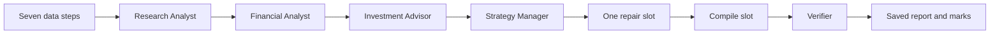

# Checkpoint 2 equity research desk

This folder contains a LangGraph agent-team implementation and a working offline review page for FIN 67110. The user requested offline completion on November 6, 2026 because API access was unavailable.

**Status: offline work is complete. The graded model-backed proof is not complete.** No four-role model run or semantic verifier run is claimed. OpenAI returned insufficient credits during the connection check; no further API calls were made after the user requested offline work. Anthropic support is implemented but has not been tested against its API.

## Open the page

From this folder:

```sh
.venv/bin/python -m streamlit run app.py --server.address 127.0.0.1 --browser.gatherUsageStats false
```

Open **http://localhost:8501**. The default mode is **Saved report review (offline)**. Choose KO or COST and press **Run offline checks**. The page displays the core numerical marks, the saved fallback report, and the supplied-price scenario. A new folder is created for each review. This mode makes no API calls.

On this Mac, you can also double-click `launch.command` in Finder to start the page. Once it is running, the reviewer uses the browser.

## Install

Python 3.11 or later is required. Open a terminal in this uploaded repository folder, confirm that your `python3` is version 3.11 or later, then run:

```sh
python3 --version
python3 -m venv .venv
.venv/bin/python -m pip install -r requirements-lock.txt
```

If `python3` is older than 3.11, use an installed Python 3.11+ interpreter instead. The lock file records the tested versions; requirements.txt holds the allowed ranges. No virtual environment is included in this upload copy.

## What is implemented

The seven SEC data steps remain in `sec_data.py`. They resolve a ticker, select filings, save documents and numbered text, select annual facts, calculate ratios, identify quarterly source lines, and compare peers. The steps run in code, without a model. The public team command has no flag to bypass its Verifier.



The order is fixed by LangGraph edges. The repair slot visits owners in the same fixed order and calls only those with failing content. It never calls an analyst more than twice. The Manager gets at most two calls. No model chooses the next graph node. Initial roles each use one model call; a Financial Analyst calculation request is evaluated in Python without an additional model call.

Each analyst receives only its assigned JSON task, context and expected output. The Research Analyst receives selected annual text, the release and filing metadata. The Financial Analyst receives facts, ratios, peers and the release. The Investment Advisor receives only the other two analyses. The Manager receives the analyses and the release opening for its Insight check.

The Verifier receives only the compiled report, saved filing text and saved facts. It receives no analyst personas or intermediate analyses. Code checks exact tag/period facts, quoted source text with whitespace tolerance, numerical tokens and arithmetic. The model checks the cited period, definition and meaning. Unsourced claims are unsupported. The model extracts claims, so extraction coverage and semantic judgments remain fallible. Human review is necessary. The thesis itself is excluded, while factual numbers used by the thesis remain subject to checks. An omitted required claim and the quality of an investment thesis require human judgment.

The Manager checks all five sections, consistency, and three sourced Insight lines. It rejects an insight that merely restates a figure in the release's opening paragraph. Its semantic checks have not been live-tested. Final structure results and bounded call counts are saved.

## Personas

The three analyst files in `roles/` were extracted from the supplied Word document. Their wording is preserved. The Manager file is a software checklist.

The Investment Advisor's final sentence still reads `Finish with one [original sentence incomplete].` The shared program contract requires its final sourced Insight line. **The student must finish that persona sentence in their own words.** The course says the student writes the personas; no human authorship or verification is certified here.

## Offline evidence

See `OFFLINE-RESULTS.md` and `offline-proof-results.json` for links and marks. The clean Costco core table has 11 code-correct claims. The seeded annual EPS is changed from $20.76 to $21.76 and marked wrong. The invented annual revenue-growth rate is 14.14%, four percentage points above the unrounded calculated rate of 10.1436953876%, and is marked wrong.

These are **code-only numerical checks**, not a completed model-backed verifier test. The offline reader handles the existing Checkpoint 1 core-table layouts and the prepared growth sentence. It does not audit every narrative number, peer number, or definition. It does not create fresh analyst outputs or three new insights. The full Verifier is broader but awaits live validation.

Offline commands, with no API calls:

```sh
.venv/bin/python -m unittest -v test_graph.py test_verifier.py test_offline.py
.venv/bin/python offline_audit.py runs/COST_20261106T064700465418Z_sources
.venv/bin/python offline_audit.py runs/KO_20261106T064702564917Z_sources
```

## Prices and source periods

The supplied November 5, 2026 closes are COST $1,065.59 and KO $95.73, both attributed by the user to Yahoo Finance. These prices have **not** been independently checked. They are later than the saved releases, so they do not reproduce the lab's price-before-release convention. The saved data are the October 29 Checkpoint 1 source sets; importing or replaying them is not a fresh SEC retrieval. KO's saved release was filed October 27, rather than in November. The user explicitly selected KO again.

The offline scenario calculates supplied price / annual GAAP diluted EPS. This is not a current trailing-four-quarter P/E and does not revise the historical fallback recommendation. Source imports and prices are recorded in each source set's `source-provenance.json` and `bundle.json`.

## Resume live work later

Do not run these commands until API access and credits are available and live work is authorized again.

For live work, create a local `.env` beside `desk.py`, using `.env.example` as the format. A parent course `.env` is also supported. `API_KEY` or `OPENAI_API_KEY` is used for OpenAI; `ANTHROPIC_API_KEY` is used for Anthropic. Keys are never written into node payloads. Both `.env` locations are ignored by Git. No real `.env` is included in this upload copy. Financial Datasets uses `FINANCIAL_DATASETS_API_KEY`. Its key passed a one-record KO income-statement access test (HTTP 200). It supplies financial data, not analyst or semantic-verifier model calls; it is not yet wired into the desk. No financial-data API response was substituted for the saved SEC sources.

Run the whole team on the saved source sets, still executing every analyst and the mandatory Verifier:

```sh
.venv/bin/python desk.py COST --peers WMT,TGT,BJ --price 1065.59 --price-date 2026-11-05 --price-source "Yahoo Finance; user supplied" --source-run runs/COST_20261106T064700465418Z_sources --provider anthropic
.venv/bin/python desk.py KO --peers PEP,KDP --price 95.73 --price-date 2026-11-05 --price-source "Yahoo Finance; user supplied" --source-run runs/KO_20261106T064702564917Z_sources --provider anthropic
```

For fresh SEC filings, omit `--source-run`. No ticker or company name is hard-coded in the runtime program. OpenAI remains available with `--provider openai`. The model can be set explicitly with `--model`; the implemented defaults are `gpt-4.1` and `claude-sonnet-4-6`. Availability, credits and current provider limits need to be checked at the time of the live run.

Run only the Verifier on the saved seeded trial:

```sh
.venv/bin/python desk.py --verify-only runs/COST_20261106T064523320138Z_seeded-eps --provider anthropic
```

This copies the report and sources into a new run and calls only the Verifier. The original is untouched. To prepare and run all three live verifier trials:

```sh
.venv/bin/python proof.py runs/COST_20261106T064523278758Z_clean --execute --provider anthropic
```

A full run saves source documents, facts, ratios, peers, node inputs and outputs, calculator results, model usage, node order, call counts, the report, and the verified report. The verified report keeps the filings line first and places marks directly below it. Model failures do not produce a success claim. A verify-only invocation also creates a new folder. Offline outputs are named `offline-report.md`, not `verified-report.md`.

## Before submission

1. Complete the Investment Advisor persona's last sentence yourself.
2. Enable a funded provider, run COST twice, then KO, and inspect saved node order and outputs. Check the source-period and price-date differences above against the lab requirements.
3. Run the full seeded-error, invented-growth and clean-report tests. Check all eleven clean claims and ensure the Verifier cannot be skipped.
4. Have your partner run the page, inspect one Insight source, and check two core claims against the actual filings. The partner supplies the marks. Complete your own source review.
5. Resolve wrong and unsupported marks and any Manager failures; do not treat a file named verified-report as an automatic pass.
6. Add the course's exact human disclosure only after the required human review. Push a reviewed commit to the course repository and submit its commit permalink to Brightspace. Nothing has been pushed or submitted by this offline build. Team formation remains a human course task.

Checkpoint 2 is individual. The course lists the deadline as November 5, 2026 at 11:59 PM Eastern. Its graded deliverable is a commit permalink holding the agent team and the verifier's seeded-error marks.

## References

- [Week 3](https://cinderzhang.github.io/FIN67110-Fall2026/week-03/index.html)
- [Lab 04](https://cinderzhang.github.io/FIN67110-Fall2026/week-03/lab-04-the-team.html)
- [Lab 05](https://cinderzhang.github.io/FIN67110-Fall2026/week-03/lab-05-make-the-team-yours.html)
- [Grading](https://cinderzhang.github.io/FIN67110-Fall2026/grading.html)
- [LangGraph graph API](https://docs.langchain.com/oss/python/langgraph/quickstart)
- [OpenAI structured outputs](https://developers.openai.com/api/docs/guides/structured-outputs)
- [Anthropic structured outputs](https://platform.claude.com/docs/en/build-with-claude/structured-outputs)

This is a learning exercise, not financial advice.
AI assistance: OpenAI Codex; Python; LangGraph. Model-backed runs and human verification remain pending.
No student or partner sign-off is asserted. Any remaining errors require review.
